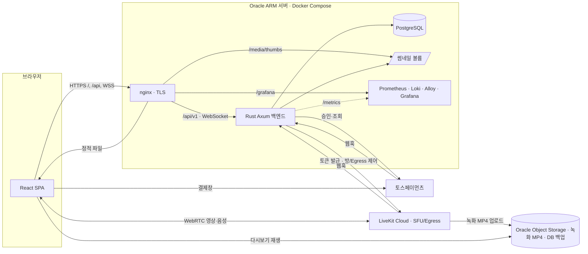

# 아키텍처

> 백엔드 1대 + 관리형 미디어 서버(LiveKit Cloud) 구조. 단일 인스턴스를 전제로 단순하게 만들고, 여러 대로 늘릴 때 바꿔야 할 지점은 `shortcut:` 주석과 이 문서 §8에 남긴다.

## 0. 구조 스타일: 모듈형 모놀리스 + 수직 분할
- **모놀리스**: 백엔드 프로그램은 하나. 마이크로서비스로 쪼개지 않는다.
- **모듈형**: 도메인별 폴더(auth, broadcast, live, chat, moderation, wallet, clutch, recording, follow). 다른 도메인의 테이블을 직접 고치지 않고, 그 도메인이 공개한 함수로 호출한다(예: `wallet::debit`).
- **수직 분할**: 기능 하나의 라우트·권한 확인·SQL이 그 도메인 폴더 안에 있다. 계층은 `handlers → db` 두 단계뿐(Service·Repository 계층 없음).
- **외부 연동만 trait로 분리**: `LiveKitApi`, `TossApi` 두 개. 운영은 실제 HTTP 구현, 시나리오 테스트는 가짜 구현(fake)을 넣어 네트워크·키 없이 웹훅 반복, 금액 불일치, 방 종료 호출 등을 재현한다. 그 외(DB 등)는 추상화하지 않는다.
- 채택 이유: 서버 1대·10일 일정에 계층형·클린·헥사고날은 보일러플레이트가 과하고, MSA는 운영 부담만 크다. 도메인 폴더 단위라 서브에이전트에게 task를 나누기 쉽다.

## 1. 전체 구성



- **영상·음성은 우리 서버를 거치지 않는다.** 브라우저 ↔ LiveKit Cloud가 WebRTC로 직접 주고받는다. 우리 서버는 "누가 송출·시청할 수 있는지"(토큰)와 방송 상태만 관리한다.
- 같은 도메인(`flutch.kro.kr`) 아래에 정적 파일·API·WebSocket을 두어 쿠키·CORS 문제를 없앤다.
- 썸네일은 서버 디스크 볼륨(nginx가 직접 서빙), 녹화는 Object Storage(공개 읽기·목록 비공개 버킷, 쓰기는 키 필요).

## 2. 핵심 흐름

### 송출 시작
1. 스트리머 `POST /api/v1/broadcasts/{id}/live` → 백엔드가 세션·소유자·상태(READY)·동시 LIVE 확인.
2. 트랜잭션으로 LIVE 전이 + `started_at` 기록 → LiveKit publish 토큰 발급(신원 `userId:tabId`) → 녹화 켜짐이면 Egress 시작 요청.
3. 브라우저가 토큰으로 LiveKit 접속, 트랙 송출: `screen_share`(+`screen_share_audio`) / `camera` / `microphone`.
4. 커밋 후 WebSocket `broadcast.updated`(LIVE) 발행.

### 시청
1. `POST /broadcasts/{id}/viewer-token` → subscribe 전용 토큰(신원 `userId|guestId:tabId`).
2. 브라우저가 LiveKit 구독. `adaptiveStream`으로 화면 크기에 맞는 화질만 받는다.
3. WebSocket `/broadcasts/{id}/events` 구독: 채팅·제목 변경·후원·게이지·종료 이벤트.

### 종료 (정상 / 비정상)
- 정상: `DELETE /live` → ENDED 전이 → LiveKit 방 삭제(송출 강제 중단) → Egress 종료 → `broadcast.ended`.
- 비정상: LiveKit 웹훅 `participant_left`(송출자) → `disconnected_at` 기록 → 스케줄러가 60초 지나도 복귀 없으면 위 종료 절차. 복귀하면 `disconnected_at` 해제.

### 결제 (충전하고 후원하기)
1. `POST /payments/orders` → 서버가 금액·목적(충전/후원)·대상 방송을 담은 대기 주문 생성(30분 만료).
2. 토스 결제창 → 성공 리다이렉트 → `POST /payments/confirm`.
3. 서버가 주문과 금액 대조 → 토스 승인 API → **한 트랜잭션**: 주문 확정(`payment_key` 유니크) + 원장 "충전" + (후원이면, 방송이 LIVE일 때만) 원장 "후원" + 후원 기록.
4. 토스 웹훅이 같은 결제를 다시 알려도 유니크 제약에 걸려 무시(멱등).

## 3. 백엔드 구조 (Rust, 단일 crate)

```
backend/src/
  main.rs            설정 로드, 마이그레이션, 라우터·스케줄러 시작
  config.rs          환경변수
  error.rs           AppError → {error:{code,message,request_id}}
  extract.rs         CurrentUser / OptionalUser 추출기(세션 쿠키)
  realtime.rs        방송별 이벤트 허브(tokio::broadcast) + WebSocket 핸들러
  scheduler.rs       주기 작업(아래 §5)
  livekit.rs         trait LiveKitApi + HTTP 구현(토큰·방·Egress), 웹훅 검증
  toss.rs            trait TossApi + HTTP 구현(승인·조회), 웹훅 검증
  routes/mod.rs      /api/v1 라우터 조립 (메인 개발 세션만 수정)
  auth/  broadcast/  live/  chat/  moderation/  wallet/  clutch/  recording/  follow/
      mod.rs         라우트
      handlers.rs    요청 처리·권한 확인
      db.rs          SQL (sqlx::query! 컴파일 검증)
backend/tests/scenarios/   시나리오 테스트 (#[sqlx::test], LiveKit·토스는 fake)
backend/migrations/        SQLx 마이그레이션
backend/data/              금지어·욕설·흔한 비밀번호 목록
```
- 계층은 **handlers → db** 두 단계. 여러 도메인이 쓰는 규칙만 함수로 뺀다(예: `wallet::debit`, `broadcast::ensure_owner`).
- 권한 확인은 핸들러 첫 줄에서: 추출기(로그인) → 소유자/차단/상태 확인 → 처리.
- API 타입은 `ts-rs`로 Rust 구조체에서 TypeScript 타입을 생성해 `frontend/src/api/generated/`에 둔다(프론트·백엔드 타입 불일치 방지).

## 4. 프론트엔드 구조 (React + Vite)

```
frontend/src/
  main.tsx, router.tsx      react-router
  api/                      fetch 래퍼, generated 타입
  components/ui/            Panel(사선 모서리)·Button·Chip·Avatar 등 디자인 시스템
  layouts/                  AppShell(사이드바·오른쪽 패널)
  pages/                    Home, Explore, Watch, Studio, Replay, Streamer, Wallet, Auth, Error
  features/<도메인>/
      hooks/                useLiveStudio, useViewer, useChat, useClutch, useWallet ...
      components/           해당 도메인 화면 조각 (표현만)
  styles/tokens.css         디자인 토큰 → Tailwind 설정
```
- 서버 상태는 **TanStack Query**, 실시간은 WebSocket 이벤트로 Query 캐시를 갱신. 전역 상태 라이브러리 없음(로그인 정보만 Context).
- LiveKit: `livekit-client` + `@livekit/components-react`. 결제: 토스 결제위젯 SDK.
- 로직은 `hooks/`, 컴포넌트는 표현만(디자인 교체 대비).

## 5. 백그라운드 작업 (scheduler.rs, 단일 인스턴스)
| 주기 | 작업 |
|---|---|
| 5초 | 60초 유예 지난 LIVE 자동 종료, 3시간 초과 LIVE 자동 종료(10분 전 경고 이벤트) |
| 1초 | Clutch 대기열 진행(히어로 5분 교대) |
| 1분 | 만료된 결제 대기 주문 정리 |
| 1시간 | 다시보기 보관 정리(30일·용량) |
| 1일 | 만료 세션 정리 |
- 모든 상태는 DB에 있고 작업은 DB를 보고 판단 → 서버 재시작에도 안전.
- 시작 시 1회: LiveKit 실제 방 목록과 LIVE 방송 동기화.

## 6. 실시간 이벤트
- 방송마다 `tokio::broadcast` 채널 하나. **DB 커밋 후** 발행.
- 이벤트 형식 `{ "type": "chat.created", "data": {...} }` (목록은 `docs/api.md`).
- 클라이언트는 끊기면 자동 재접속 후 필요한 데이터를 다시 조회(이벤트 누락 허용).
- 시청자 수: LiveKit 웹훅(참가·퇴장)으로 방송별 접속 신원 집합을 메모리에 유지 → 사용자 단위로 묶어 계산 → 변경 시 `viewer.count` 발행, 최고값은 DB 저장. 재시작 시 LiveKit 참가자 목록으로 복구.

## 7. 데이터 모델 (요약)
| 테이블 | 핵심 컬럼 |
|---|---|
| users | login_id(유니크·영구), nickname(유니크), password_hash, kakao_id, nickname_changed_at, withdrawn_at |
| sessions | id(쿠키 값의 해시), user_id, expires_at, remember |
| broadcasts | owner_id, status, title, category, tags, record, pip_corner, started_at, ended_at, disconnected_at, peak_viewers, thumbnail_path, hidden_at |
| chats | broadcast_id, streamer_id, user_id, body, edited_at, deleted_at |
| bans / ban_events | streamer_id, user_id, until(NULL=영구) / 이력 |
| follows | follower_id, streamer_id |
| wallets / ledger_entries | user_id, balance / type, amount(+/-), balance_after, 참조 id |
| payment_orders | order_id(유니크), payment_key(유니크), purpose, amount, broadcast_id, status, expires_at |
| donations | broadcast_id, donor_id, amount, kind(donation/clutch/burst), anonymous, message, ledger_entry_id |
| clutch_events / clutch_queue | broadcast_id, user_id, points, paid / status, starts_at, ends_at |
| recordings / recording_views | broadcast_id, egress_id, status, object_key, duration, expires_at, views / (recording_id, viewer_key, date) 유니크 |

## 8. 확장 시 바꿀 지점 (지금은 하지 않음)
- 백엔드 여러 대: 실시간 허브 → Redis pub/sub, 스케줄러 → 한 대만 실행(리더 선출), 시청자 수·요청 제한 메모리 상태 → Redis.
- LiveKit Cloud 한도 초과: 같은 서버(또는 별도 서버)에 LiveKit 직접 설치, URL·키만 교체.

## 9. 화면 + 웹캠 동시 송출 (PIP)
- 스트리머가 **화면 공유 트랙과 카메라 트랙을 따로** 보내고, **시청자 화면에서** 카메라를 화면 모서리에 겹쳐 그린다. 브라우저 캔버스 합성은 하지 않는다(게임 창으로 전환하면 백그라운드 탭의 그리기가 느려져 방송이 멈추기 때문).
- 위치: 스트리머가 네 모서리 중 선택 → `broadcasts.pip_corner` 저장 → `broadcast.updated`로 시청자 반영.
- 송출 중 웹캠 켜기·끄기 가능(트랙 추가·제거 → 시청자 화면 자동 반영).
- 화면 공유가 끊기고 카메라만 남으면 시청자 화면에 카메라를 크게 표시.
- 시청자: PIP 숨기기 버튼(모바일에서는 탭으로 숨김·표시).
- 녹화: LiveKit 기본 배치(화면 크게 + 카메라 옆)로 저장. 라이브와 배치가 다른 점은 README에 명시.
- 대역폭: 화면 1080p30 + 카메라 360p30(simulcast). 사양이 낮으면 카메라를 끄도록 안내.
