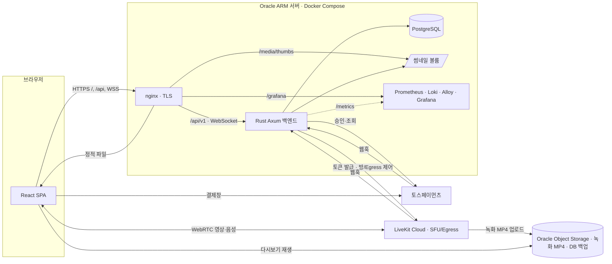

# 아키텍처

> 백엔드 1대 + 관리형 미디어 서버(LiveKit Cloud) 구조. 단일 인스턴스를 전제로 단순하게 만들고, 여러 대로 늘릴 때 바꿔야 할 지점은 `shortcut:` 주석과 이 문서 §8에 남긴다.

## 0. 구조 스타일: 모듈형 모놀리스 + 수직 분할
- **모놀리스**: 백엔드 프로그램은 하나. 마이크로서비스로 쪼개지 않는다.
- **모듈형**: 도메인별 폴더(auth, broadcast, live, chat, moderation, wallet, clutch, recording, follow). 다른 도메인의 테이블을 직접 고치지 않고, 그 도메인이 공개한 함수로 호출한다(예: `wallet::debit`).
- **수직 분할**: 기능 하나의 라우트·권한 확인·SQL이 그 도메인 폴더 안에 있다. 계층은 `handlers → db` 두 단계뿐(Service·Repository 계층 없음).
- **외부 연동만 trait로 분리**: `LiveKitApi`, `TossApi` 두 개. 운영은 실제 HTTP 구현, 시나리오 테스트는 가짜 구현(fake)을 넣어 네트워크·키 없이 웹훅 반복, 금액 불일치, 방 종료 호출 등을 재현한다. 그 외(DB 등)는 추상화하지 않는다.
- 채택 이유: 서버 1대·10일 일정에 계층형·클린·헥사고날은 보일러플레이트가 과하고, MSA는 운영 부담만 크다. 도메인 폴더 단위라 서브에이전트에게 task를 나누기 쉽다.

## 1. 전체 구성



- **영상·음성은 우리 서버를 거치지 않는다.** 브라우저 ↔ LiveKit Cloud가 WebRTC로 직접 주고받는다. 우리 서버는 "누가 송출·시청할 수 있는지"(토큰)와 방송 상태만 관리한다.
- 같은 도메인(`flutch.kro.kr`) 아래에 정적 파일·API·WebSocket을 두어 쿠키·CORS 문제를 없앤다.
- 썸네일은 서버 디스크 볼륨(nginx가 직접 서빙), 녹화는 Object Storage(공개 읽기·목록 비공개 버킷, 쓰기는 키 필요).

## 2. 핵심 흐름

### 송출 시작
1. 스트리머 `POST /api/v1/broadcasts/{id}/live` → 백엔드가 세션·소유자·상태(READY)·동시 LIVE 확인.
2. 트랜잭션으로 LIVE 전이 + `started_at` 기록 → LiveKit publish 토큰 발급(신원 `u:<userId>:<tabId>`) → 녹화 켜짐이면 Egress 시작 요청.
3. 브라우저가 토큰으로 LiveKit 접속, 트랙 송출: `screen_share`(+`screen_share_audio`) / `camera` / `microphone`.
4. 커밋 후 WebSocket `broadcast.updated`(LIVE) 발행.

### 시청
1. `POST /broadcasts/{id}/viewer-token` → subscribe 전용 토큰(신원 `u:<userId>:<tabId>` 또는 `g:<guestId>:<tabId>`).
2. 브라우저가 LiveKit 구독. `adaptiveStream`으로 화면 크기에 맞는 화질만 받는다.
3. WebSocket `/broadcasts/{id}/events` 구독: 채팅·제목 변경·후원·게이지·종료 이벤트.

### 종료 (정상 / 비정상)
- 정상: `DELETE /live` → ENDED 전이 → Egress 종료(파일 마무리) → LiveKit 방 삭제(송출 강제 중단) → `broadcast.ended`.
- 비정상: LiveKit 웹훅 `participant_left`(송출자) → `disconnected_at` 기록 → 스케줄러가 60초 지나도 복귀 없으면 위 종료 절차. 복귀하면 `disconnected_at` 해제.

### 결제 (충전하고 후원하기)
1. `POST /payments/orders` → 서버가 금액·목적(충전/후원)·대상 방송을 담은 대기 주문 생성(30분 만료).
2. 토스 결제창 → 성공 리다이렉트 → `POST /payments/confirm`.
3. 서버가 주문과 금액 대조 → 토스 승인 API → **한 트랜잭션**: 주문 확정(`payment_key` 유니크) + 원장 "충전" + (후원이면, 방송이 LIVE일 때만) 원장 "후원" + 후원 기록.
4. 토스 웹훅이 같은 결제를 다시 알려도 유니크 제약에 걸려 무시(멱등).

## 3. 백엔드 구조 (Rust, 단일 crate)

```
backend/src/
  main.rs            설정 로드, 마이그레이션, 라우터·스케줄러 시작
  lib.rs             AppState, app() 라우터 조립(main·시나리오 테스트 공용), DB 연결
  config.rs          환경변수
  error.rs           AppError → {error:{code,message,requestId}}
  extract.rs         CurrentUser / OptionalUser 추출기(세션 쿠키)
  middleware.rs      request_id·접근 로그, 변경 요청 Origin 검사(웹훅 예외)
  realtime.rs        방송별 이벤트 허브(tokio::broadcast) + WebSocket 핸들러
  scheduler.rs       주기 작업(아래 §5)
  livekit.rs         trait LiveKitApi + HTTP 구현(토큰·방·Egress), 웹훅 검증
  toss.rs            trait TossApi + HTTP 구현(승인·조회), 웹훅 검증
  routes/mod.rs      /api/v1 라우터 조립 (메인 세션만 수정)
  auth/  broadcast/  live/  chat/  moderation/  wallet/  clutch/  recording/  follow/
      mod.rs         라우트
      handlers.rs    요청 처리·권한 확인
      db.rs          SQL (sqlx::query! 컴파일 검증)
backend/tests/scenarios/   시나리오 테스트 (#[sqlx::test], LiveKit·토스는 fake). 바이너리 하나(main.rs에 도메인별 mod 한 줄), 헬퍼 common/
backend/migrations/        SQLx 마이그레이션
backend/data/              금지어·욕설·흔한 비밀번호 목록
```
- 계층은 **handlers → db** 두 단계. 여러 도메인이 쓰는 규칙만 함수로 뺀다(예: `wallet::debit`, `broadcast::ensure_owner`).
- 권한 확인은 핸들러 첫 줄에서: 추출기(로그인) → 소유자/차단/상태 확인 → 처리.
- API 타입은 `ts-rs`로 Rust 구조체에서 TypeScript 타입을 생성해 `frontend/src/api/generated/`에 둔다(프론트·백엔드 타입 불일치 방지). **i64는 TS `number`**(JSON은 number) — `backend/.cargo/config.toml`의 `TS_RS_LARGE_INT="number"`로 전체 적용되므로 필드마다 붙일 필요 없다. 생성은 `cargo test export_bindings`, CI에서 생성 결과가 커밋본과 다르면 실패.
- **충돌 방지 골격(T01에서 만든다)**: `routes/mod.rs`는 모든 도메인의 `routes()`를 미리 `merge`해 두고, 각 도메인은 자기 `mod.rs`의 Router만 채운다. 설정은 도메인별 하위 구조체(`config.chat` 등), 주기 작업은 도메인별 `register(&mut Scheduler)` 함수, 에러 코드는 도메인별 enum을 `AppError`로 변환. 그래서 서브에이전트는 공용 파일을 거의 건드리지 않는다.
- 외부 HTTP: `reqwest`(rustls, `ring` 백엔드 — Windows에서 aws-lc 빌드 도구가 필요 없게). Object Storage 삭제·용량 조회는 가벼운 S3 호환 crate 1개(path-style 주소).

## 4. 프론트엔드 구조 (React + Vite)

```
frontend/src/
  main.tsx, router.tsx      react-router
  api/                      fetch 래퍼, generated 타입
  components/ui/            Panel(사선 모서리)·Button·Chip·Avatar 등 디자인 시스템
  layouts/                  AppShell(사이드바·오른쪽 패널)
  pages/                    Home, Explore, Watch, Studio, Replay, Streamer, Wallet, Auth, Error
  features/<도메인>/
      hooks/                useLiveStudio, useViewer, useChat, useClutch, useWallet ...
      components/           해당 도메인 화면 조각 (표현만)
  styles/tokens.css         디자인 토큰 → Tailwind 설정
```
- 서버 상태는 **TanStack Query**, 실시간은 WebSocket 이벤트로 Query 캐시를 갱신. 전역 상태 라이브러리 없음(로그인 정보만 Context).
- LiveKit: `livekit-client` + `@livekit/components-react`. 결제: 토스 결제위젯 SDK.
- 로직은 `hooks/`, 컴포넌트는 표현만(디자인 교체 대비).

## 5. 백그라운드 작업 (scheduler.rs, 단일 인스턴스)
| 주기 | 작업 |
|---|---|
| 5초 | 60초 유예 지난 LIVE 자동 종료, 3시간 초과 LIVE 자동 종료(10분 전 경고 이벤트) |
| 1초 | 진행 중 SUPER CLUTCH 회전(30초 교대, 발동 5분 후 제외) |
| 1분 | 만료된 결제 대기 주문 정리 |
| 1시간 | 다시보기 보관 정리(30일·용량) |
| 1일 | 만료 세션 정리 |
- 모든 상태는 DB에 있고 작업은 DB를 보고 판단 → 서버 재시작에도 안전.
- 시작 시 1회(5초 작업의 첫 성공, 실패하면 다음 주기 재시도): LIVE 방송마다 LiveKit 실제 참가자와 동기화(시청자 수 복구, 송출자 없으면 유예 시작).

## 6. 실시간 이벤트
- 방송마다 `tokio::broadcast` 채널 하나(크기 256, 첫 연결 때 만들고 마지막 연결이 끊기면 지운다). **DB 커밋 후** 발행.
- 이벤트 형식 `{ "type": "chat.created", "data": {...} }` (목록은 `docs/api.md`).
- 클라이언트는 끊기면 자동 재접속 후 필요한 데이터를 다시 조회(이벤트 누락 허용).
- **WebSocket 인증·필터링**: 업그레이드 요청에서 `Origin`을 검사(CSWSH 방지)하고, 세션 쿠키가 있으면 사용자를 식별한다(없으면 익명 연결). 이벤트는 **연결별로 걸러서** 보낸다: `donation.created`의 익명 후원자 실명은 방송 소유자 연결에만 포함하고, 나머지 연결에는 "익명의 후원자"로 바꿔 보낸다. 이벤트를 만들 때 `public` / `owner_only` 두 형태를 같이 만들어 연결 종류에 따라 고른다.
- **홈은 WebSocket을 쓰지 않는다**: 히어로(회전 상태)·목록·사이드바는 **10초 폴링**. 히어로 전환 시각은 서버가 응답에 `slot.nextSwitchAt`으로 준다.
- 시청자 수: LiveKit 웹훅(참가·퇴장)으로 방송별 접속 신원 집합을 메모리에 유지 → 사용자 단위로 묶어 계산 → 변경 시 `viewer.count` 발행, 최고값은 DB 저장. 재시작 시 LiveKit 참가자 목록으로 복구.

## 7. 데이터 모델 (요약)
| 테이블 | 핵심 컬럼 |
|---|---|
| users | login_id(`^[a-z0-9]{4,20}$`, 유니크·영구, 카카오 계정은 NULL), password_hash(카카오 NULL), kakao_id(유니크), nickname(**활성 사용자끼리 `lower()` 유니크** — 탈퇴 후 30일 보류는 앱이 확인), nickname_changed_at, failed_login_count, locked_until(5회 실패 잠금), withdrawn_at |
| sessions | token_hash(SHA-256 32바이트 bytea, PK), user_id, expires_at, remember, last_seen_at |
| broadcasts | owner_id, status(`READY`/`LIVE`/`ENDED`, 상태별 started_at·ended_at 유무 CHECK), title, category, tags(text[], 최대 3), record, pip_corner(`top_left`/`top_right`/`bottom_left`/`bottom_right`, 기본 `bottom_right`), **publisher_identity**(현재 송출 기기의 LiveKit 신원), started_at, ended_at, disconnected_at, peak_viewers, thumbnail_path, hidden_at(ENDED만). 부분 유니크 `broadcasts_one_live_per_owner`(owner_id WHERE LIVE) |
| chats | broadcast_id, streamer_id(`(broadcast_id, streamer_id)` → broadcasts`(id, owner_id)` 복합 FK), user_id, body(원문), edited_at, deleted_at |
| bans / ban_events | streamer_id, user_id, until(NULL=영구), `(streamer_id, user_id)` 유니크 = 현재 상태 / action(`timeout`/`ban`/`unban`), until — **추가만**(트리거) |
| follows | follower_id, streamer_id, 유니크·자기 자신 금지 |
| wallets / ledger_entries | user_id(PK), balance `CHECK (balance BETWEEN 0 AND 3000000)` / user_id, type, amount(charge만 +, 나머지 -), balance_after, payment_order_id(charge만, **유니크**), broadcast_id(donation·clutch·burst만), created_at — **추가만**(UPDATE·DELETE·TRUNCATE 트리거 거절) |
| payment_orders | order_id(유니크), payment_key(유니크), user_id, purpose(`charge`/`donation`), amount(결제=충전 금액), broadcast_id·donation_amount·donation_anonymous·donation_message(donation 주문만), status(`pending`/`done`/`expired`/`failed`), expires_at, confirmed_at |
| donations | broadcast_id, donor_id, amount, kind(donation/clutch/burst), anonymous, message, ledger_entry_id(유니크, 차감 원장을 가리킴 — 원장 쪽에 donation_id는 두지 않음) |
| clutch_events / super_clutches | broadcast_id, user_id, source(`free`/`paid`/`burst`/`donation` — 게이지 점수 출처를 한 테이블에. `donation`은 T43부터 쓰지 않음, 후원은 게이지 미반영), points, created_at / broadcast_id, triggered_at, expires_at(=+5분), rotation_order, shown_at(히어로 회전 마지막 슬롯 시작, T29) |
| recordings / recording_views | broadcast_id(유니크, 1:1), egress_id(유니크), status(`recording`/`ready`/`failed`/`deleted`), object_key, **size_bytes**, duration_sec, expires_at, video_started_at(영상 0초 실제 시각, Egress 파일 시작 — 다시보기·클립 시간 기준), views / (recording_id, viewer_key(`u:<id>`/`g:<익명id>`), date_kst(기본값 KST 오늘)) 유니크 |

### 7-1. 데이터 기본 규칙
- **ID**: 모든 테이블 `BIGINT GENERATED ALWAYS AS IDENTITY`(채팅 커서 페이지네이션이 증가하는 id를 전제).
- **돈**: 비트는 `BIGINT` 정수. 원 단위 소수 없음.
- **시간**: `timestamptz`로 저장하고 Postgres `timezone`은 **UTC로 고정**(compose에 `PGTZ=UTC`, 연결 시 `SET TIME ZONE 'UTC'`). API는 UTC(`Z`) RFC 3339로 주고받고, **화면은 KST로 표시**(`Intl.DateTimeFormat('ko-KR', {timeZone: 'Asia/Seoul'})`). "하루"(조회수)·"최근 7일"·"월 필터"의 경계는 **KST(Asia/Seoul)**로 계산.
- **OS·컨테이너 시간대**: 개발 WSL과 운영 서버 OS는 `Asia/Seoul`(로그 읽기·cron 기준). 앱 컨테이너는 `TZ=Asia/Seoul` 환경변수, `tracing` 로그 시각은 `+09:00` 오프셋 포함. 백업 등 cron은 KST 기준(예: 매일 04:00 KST).
- **원장**:
  - 유형: `charge`(+), `grant`(+, 테스트 지급 — 로컬 QA 시드 `backend/scripts/seed_qa.sql`만 넣음, 주문·방송 참조 없음), `donation`(-), `clutch`(-), `burst`(-), `withdraw_forfeit`(-). 참조는 유형별 nullable FK 컬럼.
  - 차감: `UPDATE wallets SET balance = balance - $n WHERE user_id = $u AND balance >= $n RETURNING balance` → 그 값을 `balance_after`로 같은 트랜잭션에서 원장에 추가.
  - **스트리머는 받은 비트를 원장에 적립받지 않는다**(정산 없음, 받은 비트를 다시 쓰면 안 됨). 받은 합계는 `donations`에서 집계.
- **세션**: 32바이트 랜덤 토큰(base64url)을 쿠키 `flutch_session`(httpOnly·Secure·SameSite=Lax)에, DB에는 SHA-256 해시만. 연장은 `last_seen_at`이 1시간 이상 지났을 때만 UPDATE. LIVE 송출 중인 사용자의 세션은 만료 작업이 건너뛴다.

## 7-2. 결제 웹훅
- 토스 웹훅(`PAYMENT_STATUS_CHANGED`)은 헤더 서명이 아니라 **본문의 `paymentKey`로 결제 조회 API를 다시 호출**해 상태·금액을 확인하고 확정한다(본문의 `secret`은 결제 객체의 `secret`과 대조). 확정은 `payment_key` 유니크로 멱등.
- 결제위젯을 쓰므로 키는 **결제위젯 연동 키**(클라이언트 `test_gck_…`, 시크릿 `test_gsk_…`).
- 결제 조회는 `GET /v1/payments/{paymentKey}`만 쓴다. orderId 조회(`/v1/payments/orders/{orderId}`)는 API 개별 연동 키(`test_sk`) 전용이라 위젯 키로는 부를 수 없다(T21, 공식 문서). 웹훅은 실패 응답이면 최대 7회 재전송(1·4·16·64·256·1024·4096분).

## 8. 확장 시 바꿀 지점 (지금은 하지 않음)
- 백엔드 여러 대: 실시간 허브 → Redis pub/sub, 스케줄러 → 한 대만 실행(리더 선출), 시청자 수·요청 제한 메모리 상태 → Redis.
- LiveKit Cloud 한도 초과: 같은 서버(또는 별도 서버)에 LiveKit 직접 설치, URL·키만 교체.

## 9. 화면 + 웹캠 동시 송출 (PIP)
- 스트리머가 **화면 공유 트랙과 카메라 트랙을 따로** 보내고, **시청자 화면에서** 카메라를 화면 모서리에 겹쳐 그린다. 브라우저 캔버스 합성은 하지 않는다(게임 창으로 전환하면 백그라운드 탭의 그리기가 느려져 방송이 멈추기 때문).
- 위치: 스트리머가 네 모서리 중 선택 → `broadcasts.pip_corner` 저장 → `broadcast.updated`로 시청자 반영.
- 송출 중 웹캠 켜기·끄기 가능(트랙 추가·제거 → 시청자 화면 자동 반영).
- 화면 공유가 끊기고 카메라만 남으면 시청자 화면에 카메라를 크게 표시.
- 시청자: PIP 숨기기 버튼(모바일에서는 탭으로 숨김·표시).
- 녹화: LiveKit 기본 배치(화면 크게 + 카메라 옆)로 저장. 라이브와 배치가 다른 점은 README에 명시.
- 대역폭: 화면 1080p30 + 카메라 360p30(simulcast). 사양이 낮으면 카메라를 끄도록 안내.

## 10. 개발·배포 환경
- **로컬**: `deploy/compose.dev.yml` = Postgres + **`livekit/livekit-server --dev`**(로컬 LiveKit). 웹훅은 `http://host.docker.internal:<BACKEND_PORT>/api/v1/livekit/webhook`. 개발은 WSL2 Ubuntu에서 하고 Docker는 Docker Desktop의 WSL 연동을 쓴다. 컨테이너에서 WSL의 백엔드로 웹훅이 닿지 않으면(Desktop의 host.docker.internal은 Windows 호스트를 가리킴) compose에 `extra_hosts: ["host.docker.internal:host-gateway"]`를 넣거나 백엔드도 compose로 띄운다 — T01에서 실제로 확인하고 트러블슈팅에 기록. 로컬에서 송출·시청·웹훅·유예까지 확인한다(녹화 Egress만 배포 환경에서 확인).
- **worktree마다**: `.env`의 `BACKEND_PORT`·`VITE_PORT`·`DATABASE_URL`(DB 이름 `flutch_<task>`)을 지시서에서 정해 준다. `#[sqlx::test]`는 같은 Postgres 서버에 테스트 DB를 스스로 만든다.
- **허용 Origin**: 환경변수 `ALLOWED_ORIGINS`(로컬 `http://localhost:<VITE_PORT>`, 운영 `https://flutch.kro.kr`). 요청 제한의 클라이언트 IP는 nginx가 넣는 `X-Forwarded-For`의 첫 값만, 신뢰 프록시는 Docker 네트워크 대역.
- **CI**(GitHub Actions): Postgres service 컨테이너 + `DATABASE_URL`로 `cargo test`, 빌드는 `SQLX_OFFLINE=true`, `cargo sqlx prepare --check`, ts-rs 생성 결과 비교, 프론트 lint·typecheck·build. 캐시 `Swatinem/rust-cache`.
- **이미지 빌드**: GitHub의 **`ubuntu-24.04-arm` 러너**(비공개 저장소도 2026-01부터 지원)에서 네이티브 arm64 빌드 → GHCR. 에뮬레이션(QEMU) 빌드는 쓰지 않는다. 서버는 `read:packages` 토큰으로 pull.
- **배포**: main 머지 → 이미지 빌드 → SSH로 `docker compose pull && up -d` → `GET /api/v1/health` 확인.
  - 이미지 2개: `flutch-backend`(Rust 바이너리, `TZ=Asia/Seoul`)와 `flutch-web`(nginx + SPA 정적 파일, 한 이미지라 프론트 버전이 이미지 태그로 정해짐). 비공개 저장소라 서버는 git clone 대신 workflow가 `deploy/compose.prod.yml`·`backup.sh`·`init-cert.sh`를 scp로 올린다. 서버의 `.env`는 서버에만 있다.
  - HTTPS: 최초 1회 `init-cert.sh`(임시 80번 nginx + certbot webroot), 갱신은 `certbot` 컨테이너 루프 + `web`의 12시간 reload. nginx는 `X-Forwarded-For`를 `$remote_addr`로 덮어쓴다(위조 방지).
  - 모니터링: `compose.prod.yml`에 prometheus·loki·alloy·node-exporter·grafana(외부 포트 없음, `mem_limit`로 상한). 백엔드 `GET /metrics`(`http_requests_total{method,route,status}`·`http_request_duration_seconds`·`live_broadcasts`·`ws_connections`·`donations_total`)는 nginx가 404로 막고 Prometheus가 `backend:8080`을 직접 수집. Alloy는 Docker 소켓(읽기 전용)으로 `flutch` 프로젝트 컨테이너 로그를 Loki에 보내며 라벨은 `service`·`level`만. Grafana는 nginx `/grafana/`(하위 경로, 로그인 필수), 설정·대시보드는 `deploy/monitoring/`를 workflow가 scp로 올린다.
  - DB 백업: 호스트 cron `backup.sh` → 요일별 파일명(7개 순환 = 7일 보관) → Object Storage(키가 있을 때).
